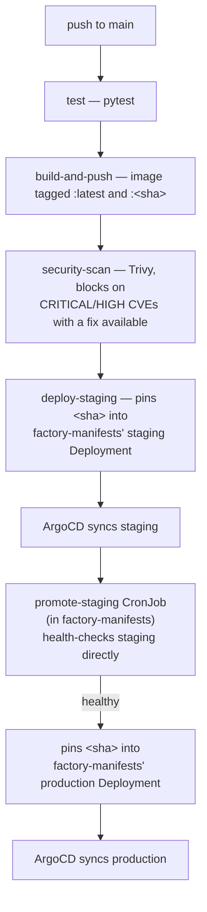

# factory-sample-app

Minimal FastAPI service with a `/hello` endpoint, a small SQLite-backed task list API, and a discount calculator. This app exists as a working example: every line of its application code, tests, and this README's API documentation was written by [`ai-software-factory`](https://github.com/egaraev/ai-software-factory)'s agent pipeline from Jira tickets, not by hand.

## Prerequisites

- Python 3.9+ (with `pip`)
- Docker for containerized runs
- `curl` for manual verification (preinstalled on most systems)

## Setup

Create a virtual environment and install the development dependencies (runtime
plus test dependencies):

```bash
python -m venv .venv
source .venv/bin/activate   # Windows: .venv\Scripts\activate
pip install -r requirements-dev.txt
```

## Run

Start the service locally with one command:

```bash
uvicorn app.main:app --reload
```

The server listens at `http://127.0.0.1:8000` and reloads automatically on
code changes. Interactive API docs are served at
`http://127.0.0.1:8000/docs`. Stop the server with `Ctrl+C`.

## Run with Docker

The service is packaged as a standalone image in the [`Dockerfile`](Dockerfile)
at the repository root. The image is based on `python:3.12-slim`, installs only
the runtime dependencies (`requirements.txt` — no pytest/httpx), and starts the
service with the production ASGI server (uvicorn, no `--reload`) as a
non-root user.

### Build the image

From the repository root:

```bash
docker build -t factory-sample-app .
```

### Run the container

The service listens on port **8000** (fixed and documented here). Map it to the
host with `-p 8000:8000`:

```bash
docker run -p 8000:8000 factory-sample-app
```

If you want Docker to remove the container automatically when it stops, add
`--rm`:

```bash
docker run --rm -p 8000:8000 factory-sample-app
```

Then, from another terminal:

```bash
curl http://localhost:8000/hello
# -> {"message": "Hello, World!"}
curl http://localhost:8000/tasks
# -> []
```

Interactive API docs are served at `http://localhost:8000/docs`.

### Persistence (task storage)

Tasks are persisted in the SQLite database file named by the `DB_PATH`
environment variable, which defaults to `/data/tasks.db` inside the container
(`data/tasks.db` when running the service locally outside Docker). That path
is declared as a Docker volume (`VOLUME /data`), so persistence survives
restarts and can be redirected in either of two ways:

- Mount a **named volume** for simple, durable storage:

  ```bash
  docker run -p 8000:8000 -v factory-data:/data factory-sample-app
  ```

- Mount a **host directory** at `/data` and explicitly keep the default
  `DB_PATH` value. Create the directory first so it exists on the host
  and can be made writable by the container user (UID `1000`) if needed:

  ```bash
  mkdir -p data
  docker run -p 8000:8000 \
    -e DB_PATH=/data/tasks.db \
    -v "$(pwd)/data":/data \
    factory-sample-app
  ```

- Or point storage at an entirely different path with `-e`:

  ```bash
  docker run -p 8000:8000 \
    -e DB_PATH=/tmp/tasks.db \
    -v "$(pwd)/tmp":/tmp \
    factory-sample-app
  ```

### Pull and run the published image from GHCR

Once the CI pipeline has published an image for `main`, it is available on
GitHub Container Registry (GHCR). The CI job tags each build with both
`latest` and the full git commit SHA, so you can run the newest published
image or pin a specific build.

For this repository, replace `egaraev` with the GitHub account or organization
that owns the repository if it is mirrored somewhere else:

```bash
docker pull ghcr.io/egaraev/factory-sample-app:latest
docker run -p 8000:8000 ghcr.io/egaraev/factory-sample-app:latest
```

To pin a specific published build, use its git commit SHA tag:

```bash
docker pull ghcr.io/egaraev/factory-sample-app:<git-commit-sha>
docker run -p 8000:8000 ghcr.io/egaraev/factory-sample-app:<git-commit-sha>
```

## Deployment (CI/CD)

A push to `main` carries a build all the way to production on its own — no manual `kubectl rollout restart`, and no build ever reaches production without first proving itself healthy in staging:



1. **test** — installs the dev dependencies and runs `pytest`.
2. **build-and-push** — builds the Docker image and pushes it to GHCR under
   two tags: `ghcr.io/egaraev/factory-sample-app:latest` and
   `ghcr.io/egaraev/factory-sample-app:<git-commit-sha>`.
3. **security-scan** — scans the exact `<sha>`-tagged image with Trivy and fails the build on any CRITICAL or HIGH severity CVE that has a fix available.
4. **deploy-staging** — checks out [`egaraev/factory-manifests`](https://github.com/egaraev/factory-manifests) and pins the staging Deployment's `image:` line to this build's `<sha>`. ArgoCD (automated sync + self-heal on that repo) rolls staging to the new build on its own.
5. **promotion** — a separate CronJob in `factory-manifests` (`promote_staging.py`, not part of this repo's CI) polls staging against production, confirms staging's own health endpoint answers, and only then pins production's Deployment to the same `<sha>`. ArgoCD syncs production the same way it synced staging.

This repository's CI never touches production directly — pinning an immutable `<sha>` tag at each stage, instead of ever deploying `:latest`, is what makes every step of this chain a real, observable git commit rather than an in-place mutation.

## Verify manually

With the server running, request the greeting endpoint in a second terminal:

```bash
curl http://127.0.0.1:8000/hello
```

Expected response:

```json
{"message": "Hello, World!"}
```

## Task API

Tasks are stored in `data/tasks.db` (a SQLite database) by default, so they
persist across service restarts. The file is created automatically when the
service starts. You can override the storage location with the `DB_PATH`
environment variable.

### Create a task

`POST /tasks` accepts a title and an optional done flag:

```bash
curl -X POST http://127.0.0.1:8000/tasks \
  -H "Content-Type: application/json" \
  -d '{"title": "Buy milk"}'
```

Expected response (`201 Created`):

```json
{"id": 1, "title": "Buy milk", "done": false}
```

To create a task that is already done:

```bash
curl -X POST http://127.0.0.1:8000/tasks \
  -H "Content-Type: application/json" \
  -d '{"title": "Walk dog", "done": true}'
```

### List all tasks

`GET /tasks` returns all tasks in id order:

```bash
curl http://127.0.0.1:8000/tasks
```

Expected response (`200 OK`):

```json
[
  {"id": 1, "title": "Buy milk", "done": false},
  {"id": 2, "title": "Walk dog", "done": true}
]
```

You can filter the list by completion status with the optional `done` query
parameter. Omitting it (the default) returns every task, as above; passing
`?done=true` or `?done=false` returns only tasks matching that status:

```bash
curl "http://127.0.0.1:8000/tasks?done=true"
curl "http://127.0.0.1:8000/tasks?done=false"
```

Expected response for `GET /tasks?done=true` (`200 OK`):

```json
[
  {"id": 2, "title": "Walk dog", "done": true}
]
```

Expected response for `GET /tasks?done=false` (`200 OK`):

```json
[
  {"id": 1, "title": "Buy milk", "done": false}
]
```

A filter that matches no tasks returns an empty list (`[]`), and values FastAPI
cannot parse as a boolean (e.g. `?done=banana`) are rejected with `422 Unprocessable Entity`.

### Get one task

`GET /tasks/{task_id}` returns a single task or `404 Not Found` when the id
does not exist:

```bash
curl http://127.0.0.1:8000/tasks/1
```

Expected response (`200 OK`):

```json
{"id": 1, "title": "Buy milk", "done": false}
```

Not-found response (`404 Not Found`):

```json
{"detail": "Task not found"}
```

### Mark a task complete or incomplete

`PATCH /tasks/{task_id}` is the completion-focused endpoint: its body must
include a `done` flag, which sets the task's status to completed (`true`) or
incomplete (`false`) and returns the updated task. The title is never changed
through this endpoint. A missing task returns `404 Not Found`, and an empty or
otherwise invalid body (e.g. a request with no `done` field) is rejected with
`422 Unprocessable Entity`:

To mark a task complete:

```bash
curl -X PATCH http://127.0.0.1:8000/tasks/1 \
  -H "Content-Type: application/json" \
  -d '{"done": true}'
```

Expected response after marking the task complete (`200 OK`):

```json
{"id": 1, "title": "Buy milk", "done": true}
```

To mark it incomplete again:

```bash
curl -X PATCH http://127.0.0.1:8000/tasks/1 \
  -H "Content-Type: application/json" \
  -d '{"done": false}'
```

Expected response after marking the task incomplete (`200 OK`):

```json
{"id": 1, "title": "Buy milk", "done": false}
```

Not-found response (`404 Not Found`):

```json
{"detail": "Task not found"}
```

### Update a task

`PUT /tasks/{task_id}` accepts any subset of `title` and `done`. Fields left
out are unchanged. Missing tasks return `404 Not Found`:

```bash
curl -X PUT http://127.0.0.1:8000/tasks/1 \
  -H "Content-Type: application/json" \
  -d '{"title": "Buy oat milk"}'

curl -X PUT http://127.0.0.1:8000/tasks/1 \
  -H "Content-Type: application/json" \
  -d '{"done": true}'
```

Expected response after the first update (`200 OK`):

```json
{"id": 1, "title": "Buy oat milk", "done": false}
```

Expected response after the second update (`200 OK`):

```json
{"id": 1, "title": "Buy oat milk", "done": true}
```

Not-found response (`404 Not Found`):

```json
{"detail": "Task not found"}
```

### Delete a task

`DELETE /tasks/{task_id}` deletes the task and returns `204 No Content` with
no body. Missing tasks return `404 Not Found`:

```bash
curl -X DELETE http://127.0.0.1:8000/tasks/1
```

Success response:

```text
204 No Content
```

Not-found response (`404 Not Found`):

```json
{"detail": "Task not found"}
```

## Discount API

`POST /discount` takes an order total and a customer tier and returns the
discount percentage to apply to the order — a stateless calculation with no
persistence. The request body carries two fields, `order_total` (a positive
number) and `customer_tier` (a string). The discount rules (the 100 boundary is
inclusive):

- **gold**: 15% if `order_total >= 100`, else 5%
- **silver**: 10% if `order_total >= 100`, else 0%
- **bronze** (and any other unrecognized tier): 0% regardless of the total

`order_total` must be a positive number: zero, negative, non-numeric values, or
a missing field are rejected with `422 Unprocessable Entity`. Tier matching is
an exact match on `"gold"`/`"silver"` (case-sensitive); anything else is
treated like bronze. The response body carries the percentage in the
`discount` key:

```bash
curl -X POST http://127.0.0.1:8000/discount \
  -H "Content-Type: application/json" \
  -d '{"order_total": 150, "customer_tier": "gold"}'
```

Expected response (`200 OK`):

```json
{"discount": 15.0}
```

An order below the threshold with a tier that never discounts:

```bash
curl -X POST http://127.0.0.1:8000/discount \
  -H "Content-Type: application/json" \
  -d '{"order_total": 50, "customer_tier": "bronze"}'
```

Expected response (`200 OK`):

```json
{"discount": 0.0}
```

An invalid `order_total` is rejected by request validation before any
calculation happens. For example, sending zero:

```bash
curl -X POST http://127.0.0.1:8000/discount \
  -H "Content-Type: application/json" \
  -d '{"order_total": 0, "customer_tier": "gold"}'
```

Expected response (`422 Unprocessable Entity`); FastAPI returns pydantic's
validation error for the offending field (the `url` version suffix varies with
the installed pydantic release):

```json
{
  "detail": [
    {
      "type": "greater_than",
      "loc": ["body", "order_total"],
      "msg": "Input should be greater than 0",
      "input": 0,
      "ctx": {"gt": 0},
      "url": "https://errors.pydantic.dev/2.x/v/greater_than"
    }
  ]
}
```

Negative or non-numeric `order_total` values — and a request missing the field
entirely — are rejected the same way.

## Test

```bash
pytest
```

Tests are isolated: each test redirects the storage layer to a temporary
SQLite database (per-test `tmp_path`) and never touches a shared or real
database file.

## Project structure

```
app/
  __init__.py
  main.py          # FastAPI app + /hello endpoint + task/discount router wiring
  schemas.py       # Pydantic models for request/response payloads
  storage.py       # SQLite-backed persistence layer
  tasks.py         # Task CRUD API routes
  discount.py      # calculate_discount + POST /discount router
tests/
  test_hello.py    # endpoint test
  test_schemas.py  # schema tests
  test_storage.py  # persistence layer tests
  test_tasks.py    # task endpoint tests
  test_discount.py # calculate_discount + endpoint tests
requirements.txt
requirements-dev.txt
Dockerfile
.dockerignore
README.md
```
